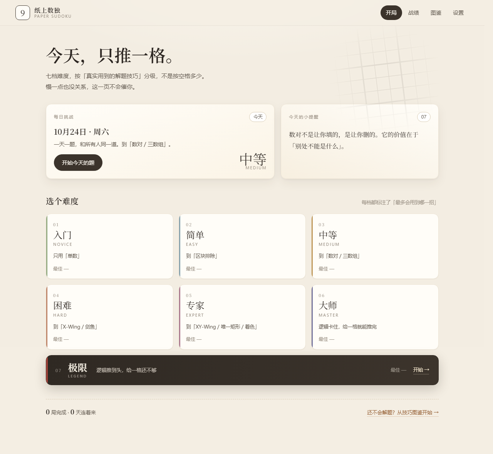
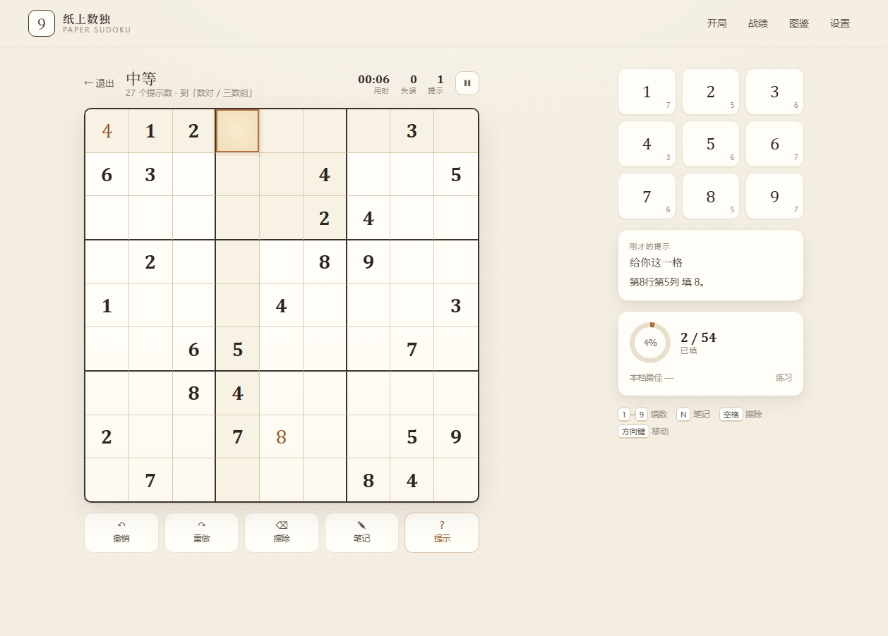
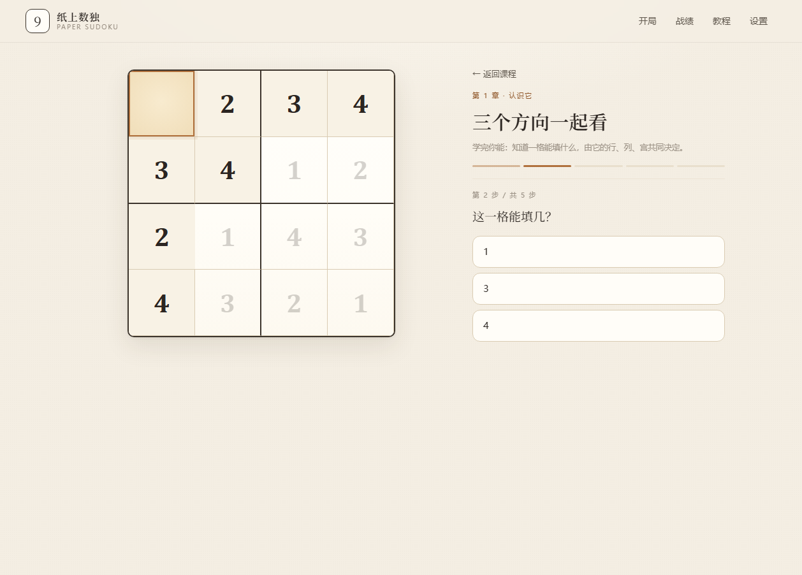
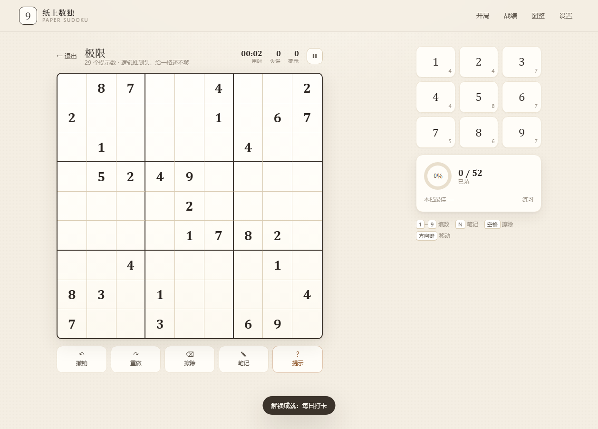

# 纸上数独 · Paper Sudoku

一个纯静态的数独小站。没有构建、没有后端、没有账号，**双击 `index.html` 就能玩**，断网也能玩。

**▶ 在线试玩：<https://harukafreeze.github.io/paper-sudoku/>**



---

## 打开方式

三种都行：

1. **在线版**：<https://harukafreeze.github.io/paper-sudoku/>（GitHub Pages，手机也能开）
2. **本地文件**：双击 `index.html`
3. **本地服务器**：

```powershell
# 在本目录下
python -m http.server 8080
# 然后打开 http://127.0.0.1:8080
```

`file://` 下 localStorage 也能用，成绩存得住。

---

## 有什么

**对局**
- 七档难度：入门 / 简单 / 中等 / 困难 / 专家 / 大师 / 极限
- 键盘、鼠标、手机都能下：`1–9` 填数、`N` 笔记、`空格` 擦除、方向键移动、`Ctrl+Z` 撤销
- 笔记（候选数）、自动清理同宫同行同列的笔记
- 冲突高亮、同行同列同宫高亮、同数字高亮
- 撤销 / 重做 / 暂停（切到别的标签页会自动暂停）/ 计时 / 失误计数
- **三级提示**：先告诉你「该用哪个技巧」，再指位置，最后才给答案
- 计分、三星评价、每档最佳用时与最高分、连胜、最近对局

**趣味**
- 每日挑战：用日期做种子，同一天所有人同一道题，成绩可复制分享
- 11 个成就（零失误、90 秒入门、全档通、极限通关、凌晨通关……）
- 每局结束告诉你「这局用到了哪几招」
- 首页每天轮换一条解题小提醒

**教学**
- 12 节互动课：不是读文档，是给你一道**真的需要这一招**的题，截到那一步让你点。
  点对了才讲为什么，点错会给针对性提示。
- 技巧图鉴：11 张卡片，标注每招属于哪一档、什么时候该想到它。
- 难度对照表：一眼看清「这一档最多会用到哪几招」。




---

## 难度是怎么定的

这是整个项目里唯一值得展开讲的设计。

**不按空格数分级。** 空格多不等于难——24 个提示数的题可能一眼看穿，30 个的反而卡死。
所以这里写了一个「只会人类技巧」的求解器，按固定顺序尝试：

```
唯一候选 → 隐性唯一 → 区块排除 → 数对/三数组 →
X-Wing → 剑鱼 → XY-Wing → 唯一矩形 → 单数着色
```

每解一题，它记录**必须用到的最难那一招**，以此定档：

| 档位 | 最多会用到 | 出题时的目标提示数 |
| --- | --- | --- |
| 入门 | 唯一候选、隐性唯一 | 38–46 |
| 简单 | ＋ 区块排除 | 30–36 |
| 中等 | ＋ 数对、三数组 | 27–33 |
| 困难 | ＋ X-Wing、剑鱼 | 23–28 |
| 专家 | ＋ XY-Wing、唯一矩形、单数着色 | 22–26 |
| 大师 | 上面全用尽仍推不动，**给一格正确答案**就能一路推完 | 21–25 |
| 极限 | 给一格还不够，**得连着试两次以上** | 21–24 |

出题流程：随机终盘 → 180° 对称挖空（每挖一格都校验唯一解）→ 用上面的求解器打分 →
**不合目标档位就重抽**。实测每档命中率 100%，单局 0–130ms。

> 一个反直觉的实测结果：随机生成的最小提示数题目里，约 65% 只用「单数」就能解完，
> 约 16% 连着色都推不动。中间几档各只有 2%–6%。
> 所以「难度」必须靠技巧求解器筛，靠挖空数量筛是筛不出来的。

**大师和极限差在哪**：都是逻辑推不动，区别在「还要喂几格」。
求解器模拟「每次挑候选数最少的格子揭示正确答案」，直到能一路推完：

- 给 1 格就通 → 大师
- 给 1 格还是卡 → 极限

实测卡住的题里，只有 17% 是「给一格就通」，剩下的都是极限。这个判据很便宜（几毫秒），
所以极限档的出题反而比大师档快——它不用碰运气去找那 17%。



---

## 文件结构

```
sudoku/
├── index.html          页面骨架
├── css/style.css       全部样式（纸感主题、响应式）
├── js/
│   ├── core.js         规则 / 求解器 / 11 种人类技巧 / 难度评级 / 出题
│   ├── storage.js      localStorage 存档：战绩、成就、课程进度、未完成对局
│   ├── game.js         一局的状态机：输入、撤销、计时、计分、三级提示
│   ├── tutorial.js     12 节课的文案 + 现场生成教学例子
│   ├── ui.js           所有 DOM、屏幕切换、动画
│   └── main.js         启动
├── tools/
│   ├── self-test.js    内核自检（求解器 / 推理健全性 / 七档出题 / 课程示例）
│   └── browser-test.js 浏览器端到端测试（CDP 驱动无头 Chrome，含截图）
└── docs/preview/       截图
```

脚本是普通 `<script>`，不是 ES module——这样 `file://` 双击打开不会被 CORS 拦住。

---

## 数据

全部存在 `localStorage` 的 `paper-sudoku.v1` 里：设置、每档战绩、历史、成就、技巧统计、
每日挑战、课程进度、当前未完成的对局。

换设备或清缓存之前，去「设置 → 导出备份」存一份 JSON，新设备上「导入备份」即可。

---

## 开发者

```powershell
node tools/self-test.js      # 内核自检，约 3 秒
node tools/browser-test.js   # 端到端，需要本机装了 Chrome
```

`self-test.js` 里最关键的一项是**推理健全性**：对每道题，检查求解器每一步的落子和候选删除
是否都与唯一解一致。技巧写错通常不会报错，只会悄悄把答案删掉——所以必须拿真解对照。

`browser-test.js` 会启动无头 Chrome，跑完首页 → 开局 → 填数 → 提示 → 通关 → 战绩 → 图鉴 →
课程 → 设置 → 手机尺寸的完整流程，并把截图存到 `tools/shots/`。

---

## 已知边界

- **大师 / 极限需要试探。** 这两档的定义就是「人类技巧推不动」，所以提示无法解释逻辑，只能直接给一格。
  「极限」的题有可能需要试五六格才推得动——想清楚再点。
- 难度档位基于本项目实现的 11 种技巧。和别的 App 的「专家」不一一对应。
- 计分以「每档基准用时」为参照，基准是拍脑袋定的，玩久了可以按自己的手感在
  `core.js` 的 `DIFFS` 里改 `target` 和 `base`。
- 没有账号、没有排行榜，成绩只在这台设备上。
